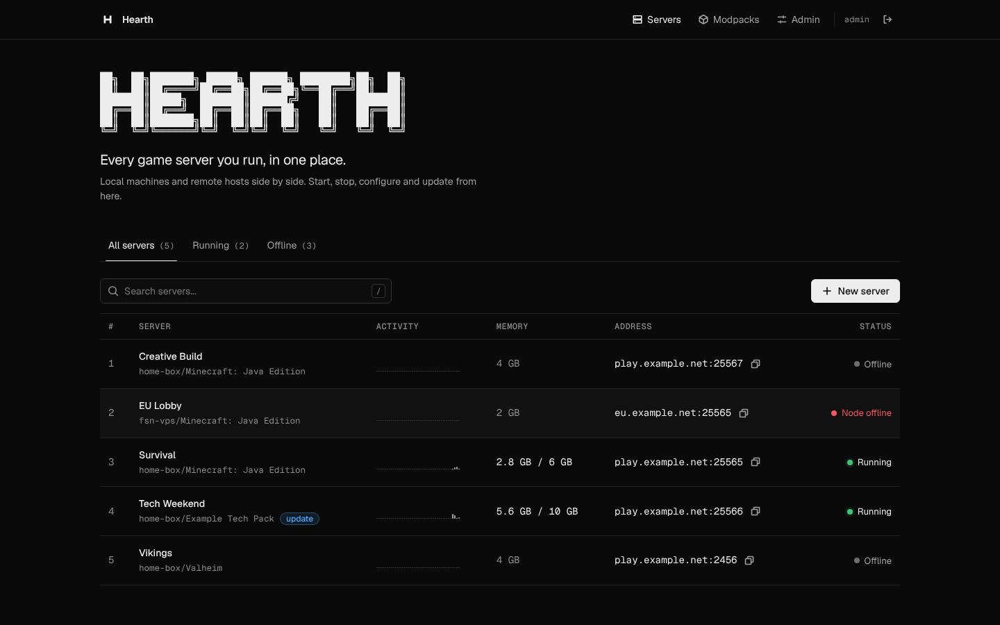
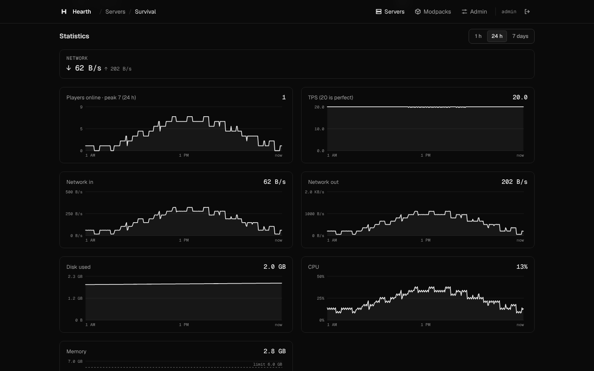

# Hearth

**A self-hosted control panel for running Minecraft and other game servers, on one machine or many.**

Hearth gives you one web panel to create, run, update and back up game servers on your own PC,
a spare machine, or rented VPSs. You can share them with friends, and they can join without you
opening ports on your router. It's in the spirit of Pterodactyl and Crafty Controller, but
simpler to set up. It's written in Python and runs everything in Docker.



> 📖 **New here?** The [full guide](docs/GUIDE.md) walks through installing, every screen,
> letting friends join, remote machines, security, the API and troubleshooting.

---

## What it does

**Run servers**
- **Minecraft: Java Edition**: Vanilla, Paper, Purpur, Fabric, Quilt, Forge and NeoForge at
  **any version**. The version list is fetched live, and Hearth picks the right Java for it.
- **Modpacks from Modrinth and CurseForge**: browse, deploy any pack at any version, and let
  Hearth update servers to new releases automatically, taking a backup first.
- **Single mods and plugins**: search Modrinth for ones that match the server's loader and
  version. Anything they require is installed too.
- **Starter packs**: Paper with Geyser and Floodgate (Bedrock players join your Java server), or
  Fabric with a performance pack, installed before the first start.
- **Velocity proxy**: put several Paper servers behind one address; Hearth sets up modern
  forwarding on every server for you.
- Also **Minecraft: Bedrock**, **Terraria**, **Factorio**, **Palworld**, **Satisfactory**,
  **Rust**, **Valheim**, and **any Docker image**.

**Manage them**
- **Live console** with search and command history, **file manager** (edit, upload, unzip,
  download), one-click `latest.log` and crash reports, **start/stop/restart**.
- **Full config**: memory (with the Java heap sized safely for you), CPU, swap, and every common
  `server.properties` setting from a form.
- **Backups**: manual, scheduled, and automatic before updates and restores. The server stays
  online while a backup runs. **Off-site copies** to any S3-compatible storage (Backblaze B2,
  Cloudflare R2, AWS, Wasabi, MinIO), and a nightly copy of the panel's own database.
- **Disk limits** per server, enforced on uploads and installs, with warnings at 90%.
- **Schedules**: nightly restarts with in-game countdowns, backups, and console commands.
- **Players**: who's online, whitelist, operators, kicks and bans, plus playtime and peaks.
- **Worlds**: download a world as a zip, or upload a singleplayer world to replace it.
- **Make a copy** of a server to try an update safely, **move it to another machine**, or
  **pause it for maintenance** (schedules, auto-updates and auto-sleep wait).
- **Stats**: live CPU, memory, disk and network, plus 24-hour memory and CPU graphs.

**Share them**
- **Friends**: give someone access to one server with exactly the permissions you choose.
- **Quotas**: let a user create their own servers, up to a number of servers and amount of memory.
- **No port forwarding needed**: built-in [playit.gg](https://playit.gg) tunnel support, and a
  "Check if friends can join" test that checks your server from the internet.
- **Sleep when empty**: an idle server stops to free memory and starts again when someone joins.
- **Notifications**: Discord messages when a server starts, stops, crashes, runs out of memory,
  updates or finishes a backup. **Admin alerts** for crash loops (the server is stopped), full
  disks, failed backups and machines going offline.

**Run it seriously**
- **Many machines** ("nodes") from one panel: your PC, a home server, VPSs from any provider.
- **Two-factor sign-in**, **API tokens**, signed **webhooks**, an **activity log**, and
  **suspend/unsuspend** (enough to connect a billing system if you rent servers out).
- A **setup wizard** on first run, **light and dark themes**, and **English or French**.
- Works on phones.



---

## How it works

Hearth has two parts, both running in Docker:

```
                 your browser
                      │  web UI + API (sign-in session)
             ┌────────▼─────────┐
             │   Hearth panel   │  users, servers, schedules, backups list,
             │ FastAPI + SQLite │  modpack catalog, notifications
             └───┬──────────┬───┘
     HTTP + WS   │          │   HTTPS + WSS  (secret token per node)
          ┌──────▼─────┐ ┌──▼───────────┐
          │   agent    │ │    agent     │   one per machine ("node")
          │ (this PC)  │ │ (rented VPS) │
          └──────┬─────┘ └──────┬───────┘
                 │ Docker       │ Docker
      ┌──────────┼───────┐      └──► more game containers
      ▼          ▼       ▼
  Minecraft   Valheim  Bedrock      each server is its own container,
  container   ...      ...          with its files in a folder you choose
```

- **The panel** is the website you use. It stores accounts and settings in a small database and
  decides what each server should look like: image, memory, ports, environment.
- **The agent** runs on every machine that hosts game servers. It talks to Docker on that
  machine. It creates the server containers, streams the console, reads and writes files, and
  makes backups. The panel reaches it with a secret token. Your own PC's agent is set up for
  you, and remote machines run just the agent.
- **Game servers** are ordinary containers from well-known images, such as
  [itzg/minecraft-server](https://docker-minecraft-server.readthedocs.io/) for Minecraft. Their
  worlds and configs are plain folders on disk, in a location you pick when you install.

Background jobs in the panel watch every server for crashes and empty servers, run schedules,
and check for modpack updates. The [guide](docs/GUIDE.md#1-how-hearth-works) explains each
piece in more detail.

---

## Quick start

You need **Docker** with Compose v2. That means Docker Desktop on Windows and macOS, or Docker
Engine plus the compose plugin on Linux.

| System | Start | Stop |
|---|---|---|
| Windows | double-click **`start.bat`** | `stop.bat` |
| Linux / macOS | **`./start.sh`** | `./stop.sh` |

On the first run the script:
1. checks Docker is running, and starts Docker Desktop if it's closed;
2. asks **which drive or folder to install game servers on**, showing the free space;
3. asks **which address your friends will use** (it suggests this machine's IP);
4. writes these settings to `.env` with a random secret, builds everything, and opens the panel.

Then open **http://localhost:8000** and create your admin account. A node called **local**
is already there, so click **New server**.

Detailed steps for each system, manual setup and first-run tips are in
[Installing](docs/GUIDE.md#3-installing).

---

## Documentation

| | |
|---|---|
| [**Full guide**](docs/GUIDE.md) | Everything: install, every screen, friends joining, nodes, security, API, troubleshooting |
| [How it works](docs/GUIDE.md#1-how-hearth-works) | Panel, agents, containers, where files live, background jobs |
| [Creating a server](docs/GUIDE.md#5-creating-a-server) | Game, software and version, memory, ports, modpacks |
| [Letting friends join](docs/GUIDE.md#8-letting-friends-join) | Port forwarding, firewalls, playit.gg tunnels, the join check |
| [Remote machines](docs/GUIDE.md#12-adding-remote-machines-nodes) | Adding a VPS or second PC as a node |
| [Configuration](docs/GUIDE.md#15-configuration-reference) | Every `.env` setting |
| [API and webhooks](docs/GUIDE.md#14-api-tokens-and-webhooks) | Automating Hearth, billing integration |
| [Troubleshooting](docs/GUIDE.md#18-troubleshooting) | Restart loops, can't connect, ports in use, and more |

---

## Project layout

```
panel/            the web panel
  hearth_panel/   FastAPI app: routers (API), services (scheduler, monitor, backups, modpacks…), models
  web/            the UI: plain JavaScript modules and CSS, no build step
agent/            the node agent: Docker control, files, backups, sleeper, playit tunnel
tests/            automated tests (Docker and the internet are simulated)
tools/            demo.py (try the UI without Docker), e2e.py (browser click-through)
docs/             the guide and screenshots
docker-compose.yml, start.sh / start.bat, stop.sh / stop.bat, .env.example
```

## Development

```sh
pip install -r requirements-dev.txt
pytest                      # panel + agent tests, no Docker or internet needed
python tools/demo.py        # full UI with simulated servers at http://127.0.0.1:8000
                            #   sign in as admin / demo-password-123
python tools/e2e.py         # with the demo running: clicks through every screen in Chromium
```

The interactive API reference is served by every panel at `/api/docs`.
See [Development](docs/GUIDE.md#19-development) for how the code is organised.
