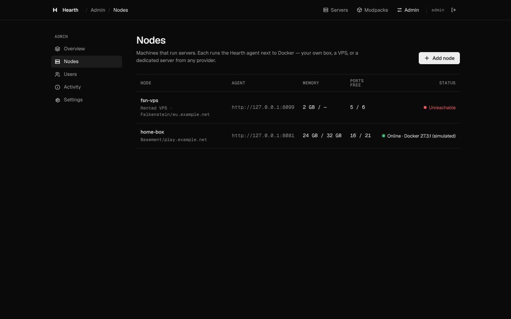
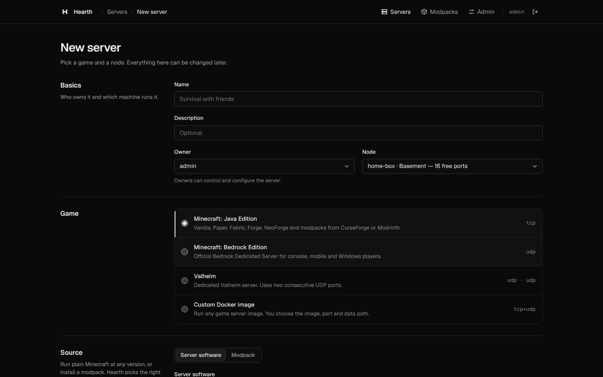
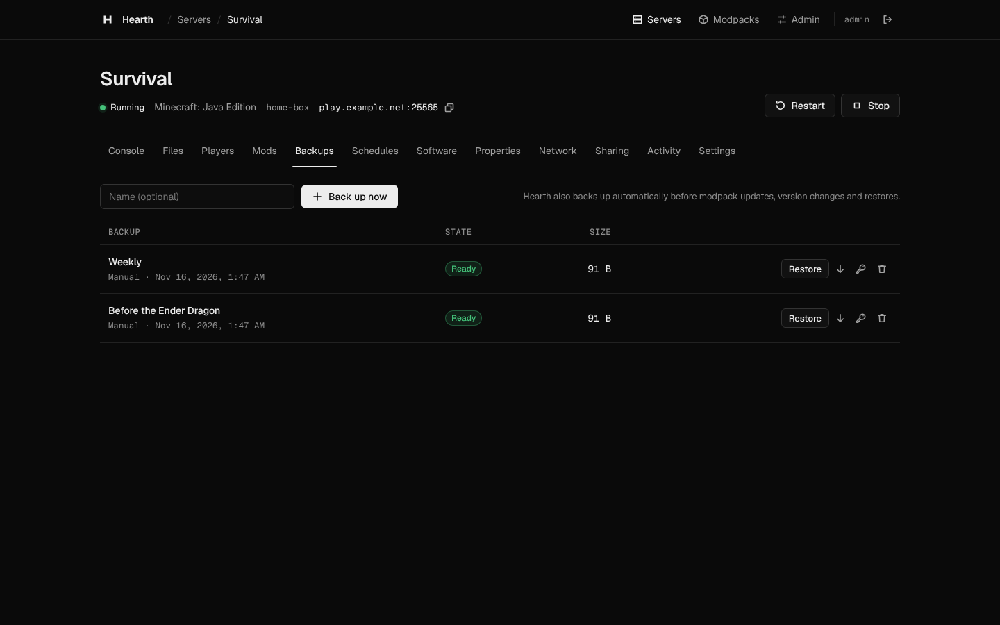
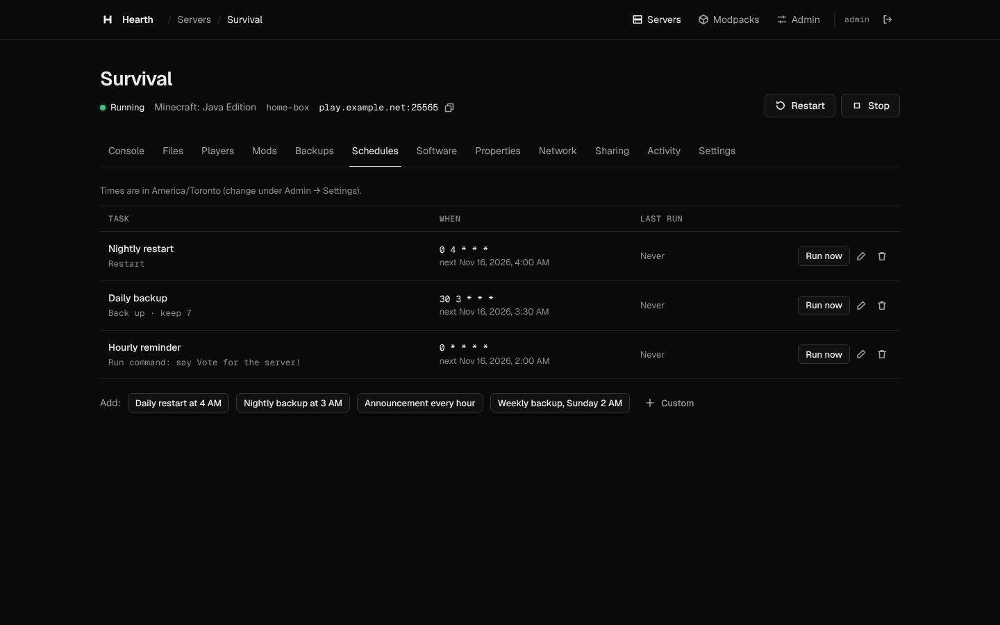
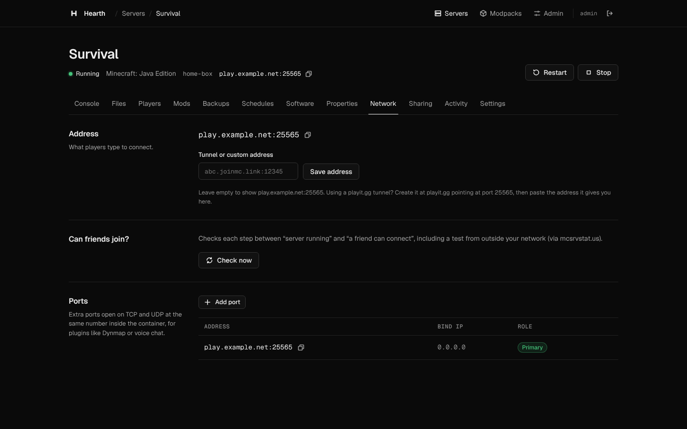

# Hearth: the complete guide

This guide covers everything about Hearth: how it works, installing it, every screen in the
panel, getting friends connected, running servers on more than one machine, security,
automation and fixing problems. The [README](../README.md) is the short version.

**Contents**

1. [How Hearth works](#1-how-hearth-works)
2. [Requirements](#2-requirements)
3. [Installing](#3-installing)
4. [First sign-in and a tour of the panel](#4-first-sign-in-and-a-tour-of-the-panel)
5. [Creating a server](#5-creating-a-server)
6. [The server page, tab by tab](#6-the-server-page-tab-by-tab)
7. [Modpacks and automatic updates](#7-modpacks-and-automatic-updates)
8. [Letting friends join](#8-letting-friends-join)
9. [Sleep when empty and wake on join](#9-sleep-when-empty-and-wake-on-join)
10. [Notifications: Discord and webhooks](#10-notifications-discord-and-webhooks)
11. [Users, sharing, quotas and suspension](#11-users-sharing-quotas-and-suspension)
12. [Adding remote machines (nodes)](#12-adding-remote-machines-nodes)
13. [Security](#13-security)
14. [API tokens and webhooks](#14-api-tokens-and-webhooks)
15. [Configuration reference](#15-configuration-reference)
16. [Where your data lives](#16-where-your-data-lives)
17. [Upgrading Hearth](#17-upgrading-hearth)
18. [Troubleshooting](#18-troubleshooting)
19. [Development](#19-development)
20. [Known limitations](#20-known-limitations)

---

## 1. How Hearth works

### The pieces

| Piece | What it is | Where it runs |
|---|---|---|
| **Panel** | The website and API. Stores users, servers, schedules, backup records and settings in a database (SQLite by default). | One container, on the machine you install Hearth on |
| **Agent** | A small service that controls Docker on one machine: creates server containers, streams consoles, handles files and backups. | One container per machine that hosts game servers |
| **Node** | The panel's name for a machine with an agent. Each node has an address, a secret token and a set of ports. | Your PC is the node called `local`; add VPSs or other PCs as more nodes |
| **Server** | One game server, as its own Docker container with its own folder of files. | On a node |

The panel never runs game servers itself. It tells an agent what each server should look like:
the Docker image, memory and CPU limits, ports, environment variables and startup options.
The agent makes Docker match that. When you press **Start**, the panel asks the agent, and the
agent starts the container.

### What happens when you create a Minecraft server

1. You pick a node, the software (say Paper 1.21.4), the memory and the settings.
2. The panel saves the server and **claims a free port** on that node (25565 for the first
   Minecraft server, then 25566, and so on).
3. It builds a **spec** for the agent. For Minecraft this uses the popular
   `itzg/minecraft-server` image, with the right Java version tag for the Minecraft version, and
   environment variables like `TYPE=PAPER`, `VERSION=1.21.4`, `MEMORY=…`, `MOTD=…`.
4. The agent pulls the image if needed and creates the container. The server's folder on disk
   is mounted into it, and its port is published on the machine.
5. On first start the image downloads the server jar (or the modpack) into that folder and boots.
   You watch all of this live in the **Console** tab.

### Memory is sized safely

A Java server uses noticeably more memory than its "heap" (the `-Xmx` value). If heap plus the
rest goes over the container's limit, Docker kills the server and it restarts in a loop. Hearth
sets the heap to the memory you assign **minus a safety margin**: a quarter of it, at least
768 MB and at most 2 GB. A 6 GB server gets a 4.5 GB heap, and a 16 GB server gets a 14 GB heap.

### Background jobs in the panel

| Job | How often | What it does |
|---|---|---|
| **Monitor** | every 15 s | Notices when servers start, stop, crash or run out of memory, and records and announces it. Puts empty servers to sleep. Keeps suspended servers stopped. |
| **Scheduler** | every minute | Runs your scheduled restarts, backups and commands, in the panel's time zone. |
| **Modpack updater** | every 6 h (configurable) | Checks Modrinth and CurseForge for new modpack versions, and updates servers that have auto-update on, after a safety backup. |

### What the agent keeps track of

- Each server's **spec**, plus a marker for "this server should be running", so servers come
  back after the machine reboots.
- **Live stats** (CPU, memory, network, disk) and per-minute averages for the 24-hour graphs.
- **Out-of-memory kills**: Docker gives no log message when it kills a server for using too
  much memory. The agent watches for it, so the panel can tell you plainly.
- **Backups**, stored as `.tar.gz` archives next to the server files.

---

## 2. Requirements

- **Docker** with **Compose v2**:
  - **Windows 10/11**: [Docker Desktop](https://www.docker.com/products/docker-desktop/) with
    the WSL 2 backend (the installer's default). When asked, use **Linux containers**, not
    Windows containers.
  - **macOS**: Docker Desktop (Apple Silicon and Intel both work).
  - **Linux**: Docker Engine plus the `docker-compose-plugin` package.
- **Memory**: about 300 MB for Hearth itself, plus whatever you give your servers. A vanilla
  or Paper server is comfortable with 2–4 GB, and big modpacks want 6–10 GB.
- **Disk**: a few GB per server, more for big worlds and modpacks, and room for backups.
- **A web browser.** Any modern one, including on a phone.

The panel and agent images are built locally from this repository the first time you start, so
nothing needs to be downloaded from a registry except the base images and the game server
images.

---

## 3. Installing

### Windows

1. Install Docker Desktop and start it once. Wait until it says it's running.
2. Download this repository (green **Code** button → **Download ZIP**) and unzip it somewhere,
   for example `C:\Hearth-GSM`.
3. Double-click **`start.bat`**.
4. On the first run it asks:
   - **Which drive to install game servers on.** It lists your drives with their free space.
     Type a letter, like `D`. Servers go in `D:\Hearth`.
   - **The address friends use to connect.** It suggests this PC's network address. Press Enter
     to accept, or type your domain or public IP (see [section 8](#8-letting-friends-join)).
5. It builds Hearth (a few minutes the first time), waits for it to start, and opens
   **http://localhost:8000**.

To stop Hearth, run **`stop.bat`**. Running game servers keep running until you stop them in
the panel, so stopping Hearth doesn't kick your players.

### Linux

```sh
git clone https://github.com/crwdevtools/Hearth-GSM.git
cd Hearth-GSM
./start.sh
```

The first run lists your disks (and any folder you type) for the game server files, asks for
the address players should use, then builds and starts everything.

If Docker says "permission denied", add yourself to the `docker` group and log in again:
`sudo usermod -aG docker $USER`.

### macOS

Same as Linux: `./start.sh`. It starts Docker Desktop if it's closed. Choose a folder in your
home directory or on an external drive under `/Volumes`; Docker Desktop can reach those by
default.

### Manual setup (any system)

```sh
cp .env.example .env
# Set HEARTH_AGENT_TOKEN to a long random value, HEARTH_PUBLIC_HOST to your address,
# and HEARTH_DATA_DIR to the folder for game servers:
sed -i "s/^HEARTH_AGENT_TOKEN=.*/HEARTH_AGENT_TOKEN=$(openssl rand -hex 32)/" .env
docker compose up -d --build
```

Every setting is described in [section 15](#15-configuration-reference).

### Running it again

`start.sh` / `start.bat` are safe to run any time. After the first run they reuse `.env`,
rebuild if the code changed, and start whatever isn't running.

---

## 4. First sign-in and a tour of the panel

The first time you open the panel it asks you to **create the admin account**. That account
can do everything. Other people get their own accounts from you later ([section 11](#11-users-sharing-quotas-and-suspension)).

Right after, a short **setup wizard** asks for your time zone, shows whether your machine is
online and how many ports are free, and offers the optional Discord alerts webhook and
CurseForge key. Every step can be skipped; it's all in Admin later (the wizard is at `#/welcome`).

Until that account exists, anyone who can reach the panel could claim it. So Hearth only accepts
it **from the computer running Hearth or your local network**. If you're setting up a cloud
server and can only reach it over the internet, either use an SSH tunnel
(`ssh -L 8000:localhost:8000 you@server`, then open http://localhost:8000), or set
`HEARTH_ALLOW_REMOTE_SETUP=true` in `.env`, restart, create the account, and remove it again.

This check relies on seeing visitors' real addresses. Behind a reverse proxy, list the proxy in
`HEARTH_TRUSTED_PROXIES` so the panel reads the forwarded address. On Docker Desktop (Windows,
macOS), connections can arrive from Docker's own internal address, so every visitor looks local.
Either way, create the admin account straight after installing, before exposing the panel to the
internet.

You'll find:

- **Servers** (the home page): every server you can see, with live status, memory use, a
  small activity graph and the address to connect to (click the copy icon). Filter by
  running/offline, and press `/` to search.
- **Modpacks**: a live list of Modrinth and CurseForge modpacks to browse and deploy.
- **Admin** (admins only):
  - **Overview**: totals across all nodes.
  - **Nodes**: machines, their ports, their health and the playit.gg tunnel.
  - **Users**: accounts, admin rights, quotas, two-factor resets.
  - **Activity**: everything that happened, across all servers.
  - **Settings**: CurseForge key, time zone, how often to check for modpack updates, webhooks.
- **Your name** (top right): your account page, with password, two-factor sign-in and API tokens.

A node called **local** is already set up, with ports **25565–25575** (Minecraft Java),
**19132** (Bedrock), **2456–2457** (Valheim), **7777–7779** (Terraria, Satisfactory),
**34197** (Factorio), **8211** (Palworld) and **28015–28017** (Rust). Panels set up before
version 0.2.0 can add the new ones under Admin → Nodes → the node → **Add ports**.



---

## 5. Creating a server

Click **New server**. The form has these parts:



**Basics**: a name and an optional description. As an admin you also choose the **owner**.
The owner sees the server and has full control of it.

**Game**: one of:

| Game | Image | Default port | Minimum memory |
|---|---|---|---|
| Minecraft: Java Edition | `itzg/minecraft-server` | 25565/tcp | 1 GB |
| Minecraft: Bedrock Edition | `itzg/minecraft-bedrock-server` | 19132/udp | 512 MB |
| Valheim | `lloesche/valheim-server` | 2456–2457/udp | 2 GB |
| Terraria (TShock) | `ryshe/terraria` | 7777/tcp | 512 MB |
| Factorio | `factoriotools/factorio` | 34197/udp | 1 GB |
| Palworld | `thijsvanloef/palworld-server-docker` | 8211/udp | 8 GB |
| Satisfactory | `wolveix/satisfactory-server` | 7777/tcp+udp and 7778/tcp | 8 GB |
| Rust | `didstopia/rust-server` | 28015/udp, 28016/tcp (RCON), 28017/udp (query) | 8 GB |
| Velocity proxy | `itzg/mc-proxy` | 25565/tcp | 512 MB |
| Custom Docker image (admins only) | any | any | 128 MB |

**Starter pack** (Minecraft Java, optional): **Java + Bedrock (Geyser)** on Paper or Purpur
installs Geyser and Floodgate and gives the server port 19132/udp so Bedrock players can join;
**Fabric performance pack** installs Lithium, FerriteCore, Krypton and ModernFix.

**Velocity proxy**: create it, start it once (so Velocity writes `velocity.toml`), then tick
the Paper or Purpur servers to put behind it on the proxy's **Network** tab. Hearth turns on
modern forwarding with a shared secret and switches the backends to proxy-only, so players
can't skip the proxy. Players land on the first server you ticked.

**Source** (Minecraft Java):
- **Software**: Vanilla, Paper, Purpur (plugins), Fabric, Quilt, Forge or NeoForge (mods).
- **Version**: pick from the live list, or *Latest*. Hearth chooses the Java runtime the
  version needs: Java 8 for old versions, up to Java 21 and newer for current ones.
- Or a **modpack**: search Modrinth or CurseForge and pick a version, or leave it on the newest.
  Tick **auto-update** to follow new releases ([section 7](#7-modpacks-and-automatic-updates)).

**Resources**
- **Memory**: the hard limit. The Java heap is sized inside it automatically ([section 1](#memory-is-sized-safely)).
- **CPU**: a percentage of one core (`200` = two cores; `0` = no limit).
- **Swap** and **disk**: optional. The disk figure is shown and tracked but not enforced
  ([section 20](#20-known-limitations)).

**Port**: Hearth picks the game's usual port if it's free on that node, otherwise the next
free one. You can choose a specific free port.

**Settings**: the most-used `server.properties` options as a form: message of the day,
difficulty, game mode, max players, view/simulation distance, PvP, hardcore, whitelist,
operators, world name, seed, world type and more. Everything else can be edited later in
**Files**.

**EULA**: Minecraft servers require accepting Mojang's EULA. Tick the box.

Press **Create**. You land on the server's console, where you can watch it download and start.
The first start of a modpack can take several minutes.

---

## 6. The server page, tab by tab

The header shows the server's status, game, node and **address** (click to copy), with
**Start / Stop / Restart** buttons. While a server is starting or stopping, a **Kill** button
also appears. It force-stops a stuck server without saving. People you share a server with only see the tabs their permissions allow
([section 11](#11-users-sharing-quotas-and-suspension)).

### Console

The live server log, coloured. Type commands at the bottom without the leading `/`, for
example `say hello` or `op Steve`. On the right are live **CPU, memory, disk, network** and
**uptime**. Below are **24-hour graphs** of memory and CPU.

Typing `stop` in the console stops the server and keeps it stopped, just like the Stop button.

**Search** (above the output) shows only the lines containing what you type, with the match
marked; Esc goes back to the live view. **Up and Down** walk through the commands you've sent,
and that history is remembered in your browser. For Minecraft Java, **latest.log** downloads the
full log since the last start, and **Crash reports** opens the `crash-reports` folder.

### Files

A file manager for the server's folder:
- Browse, **edit** text files (configs, `server.properties`, scripts) in the browser.
- **Upload** files (any size), **create folders**, **rename**, **delete**, **download**.
- **Download a folder as a zip**, and **unzip** an uploaded `.zip` or `.tar.gz` in place.
- **Symbolic links** in a server's folder are listed, and can be renamed or deleted, but Hearth never
  opens or follows them. Whatever runs inside the server (a mod, a plugin) can create links, and
  following one could reach files outside the server. Backups and copies keep links as links.
- **World tools**: **Download world** zips the current world. The server saves first, so the
  copy isn't half-written. **Import world** replaces the world with an uploaded singleplayer
  world: zip the world's folder from `.minecraft/saves`. Hearth backs up the current world
  first. If the server is running, it stops for the swap and starts again. Paper's separate
  `world_nether` and `world_the_end` folders are swapped too.

### Players (Minecraft Java)

Who's online right now, the **whitelist**, **operators** and **banned players**, with buttons
to whitelist, op/deop, kick (with a reason), ban and unban. Player heads come from mc-heads.net.
The server must be running for these actions, because they're sent as console commands.

**Last 30 days** lists every player's playtime, number of sessions and when they were last
seen, plus how many played and the most that were online at once. Hearth checks who's online
once a minute while the server runs, so times are accurate to about a minute.

### Mods (Minecraft Java with Paper, Purpur, Fabric, Quilt, Forge, NeoForge or a modpack)

Search Modrinth for **plugins** (Paper/Purpur) or **mods** (Fabric/Forge/…) that match this
server's loader and Minecraft version. **Install** downloads the file into `plugins/` or
`mods/`. Any required dependencies come with it, and every download is checked against
Modrinth's checksum. The list shows what's installed, with a remove button. Restart the server
to load changes.

### Backups



- **Back up now**, with an optional name. The server keeps running: Hearth tells it to save
  everything and pause saving for the few seconds it takes to read the files, then turns saving
  back on.
- **Download** any backup as `.tar.gz`.
- **Lock** a backup so automatic clean-up never deletes it.
- **Restore** replaces the server's files with the backup. Hearth takes a "before restoring"
  backup first, so you can undo it. A running server is stopped for the restore and started
  again after. Nothing else can start or change the server while the restore runs.
- Hearth also backs up **automatically** before modpack updates, version changes and world
  imports.

Crash reports, caches, heap dumps and old compressed logs are skipped to keep backups small.
Backups are stored on the same machine as the server ([section 16](#16-where-your-data-lives)).

**Off-site copies.** In Admin → Settings → **Off-site backups**, enter any S3-compatible storage:
endpoint (for example `https://s3.us-west-002.backblazeb2.com`, or
`https://<account>.r2.cloudflarestorage.com` with region `auto`), bucket, access key and secret.
Hearth writes, reads back and deletes a test file before saving, so a typo shows up right away.
From then on every finished backup is uploaded there (big ones in 128 MB parts). The storage keys
stay in the panel: nodes only get upload links that expire. Backups show **Off-site** once
copied; a failed copy shows why and has a retry button. Deleting or pruning a backup deletes its
off-site copy. If a node loses its disk, **Get from off-site** downloads the copy back.

### Schedules



Tasks that run on a timetable:

| Action | What it does |
|---|---|
| **Restart** | Restarts the server, with optional in-game warnings ("restarting in 5 minutes", "1 minute", "10 seconds") |
| **Stop** / **Start** | Turn the server off at night and on in the morning, for example |
| **Back up** | Makes a backup and keeps only the newest *N* scheduled backups |
| **Command** | Runs any console command, such as `say Vote for us!` or `save-all` |

Use the quick presets (daily restart at 4 AM, nightly backup, hourly announcement, weekly
backup) or **Custom** with a cron expression: five fields, `minute hour day month weekday`.

| Example | Meaning |
|---|---|
| `0 4 * * *` | every day at 4:00 |
| `*/30 * * * *` | every 30 minutes |
| `0 6 * * 1-5` | weekdays at 6:00 |
| `@daily`, `@hourly`, `@weekly`, `@monthly` | shortcuts |

Times are in the **panel's time zone** (Admin → Settings). The form shows the next three run
times, so you can check a schedule before saving. A scheduled **restart or stop is skipped if
the server isn't running**, so a nightly restart never starts a server you turned off or wakes a
sleeping one. **Run now** tests a task immediately. Each task shows its last run and result.

### Software

Change the **software and version** of a Minecraft Java server (for example Paper 1.21.1 →
1.21.4, or Paper → Fabric), or switch to or from a **modpack**. Hearth takes a backup first and
won't make the change if that backup fails. Going *down* a version, or changing loaders, can
break a world, so keep that backup until you're happy.

For modpack servers this tab also shows whether an **update** is available, with buttons to
check now and to update now.

### Properties

The game's settings as a form, the same as in the create form. Saving updates the server's
configuration. Restart the server to apply the changes.

### Network



- **Address**: what players type to connect. By default it's the node's address plus the
  server's port. If you use a tunnel or a domain with a different port, put that address here,
  and it shows everywhere instead.
- **Can friends join?**: a checklist that tests, in order: the node is reachable, the server is
  running, the address isn't a local-only one, and the server can be **reached from the
  internet** (Minecraft only, checked through mcsrvstat.us). When something fails it says what
  to fix. See [section 8](#8-letting-friends-join).
- **Ports**: the ports this server uses. Admins can add extra ports, for example for a voice
  chat plugin or a map website.

### Sharing (owners and admins)

Give another user access to this server and tick what they can do: **console, power, files,
backups, schedules, settings, players**. Change or remove access any time. See
[section 11](#11-users-sharing-quotas-and-suspension).

### Activity (owners and admins)

Everything that happened to this server: who started or stopped it, commands typed, files
edited, backups, crashes and out-of-memory kills, updates, schedule results.

### Settings

- **Details**: name and description. **Resources** (memory, CPU, swap, disk) can be changed by
  admins, and by owners who have a quota.
- **Integrations**:
  - **Discord**: paste a channel webhook to get messages for this server ([section 10](#10-notifications-discord-and-webhooks)).
  - **Auto-sleep**: never, or after 10 min / 15 min / 30 min / 1 h / 3 h with nobody online,
    plus a **Wake when someone joins** checkbox ([section 9](#9-sleep-when-empty-and-wake-on-join)).
- **Maintenance**:
  - **Reinstall** re-creates the container from the current settings. Files are kept.
  - **Make a copy** creates a copy of the server on its own port, with or without its files. The
    original saves first, so the copy is consistent. Use it to test an update or new mods.
  - **Pause for maintenance** (1 minute to 7 days): schedules, modpack auto-updates, auto-sleep
    and crash-loop handling wait until it ends, so they don't get in the way while you work.
  - **Move to another node** (admins): the server is stopped and backed up, copied to the other
    machine through the panel, restored there and started again if it was running. If anything
    fails, it stays where it was. It gets new ports, so share the new address.
  - **Suspend** (admins) stops the server and blocks anyone but an admin from starting it.
  - **Delete** removes the server, its files and its backups. This can't be undone.

---

## 7. Modpacks and automatic updates

- **Modrinth** works without any setup.
- **CurseForge** needs a free API key: create one at <https://console.curseforge.com/>, then
  paste it in **Admin → Settings**, or put it in `.env` as `CURSEFORGE_API_KEY`.

On the **Modpacks** page, search, filter by Minecraft version and loader, sort by downloads or
date, and open a pack to see its versions. **Deploy** opens the create form with the pack
already chosen.

**Auto-update.** When a server has auto-update on, the updater checks for a newer **release**
(betas and alphas are ignored) every 6 hours. When it finds one, it:
1. announces "update available";
2. takes a **pre-update backup** and keeps the last 5, and **cancels the update if that backup
   fails**;
3. switches the server to the new version and restarts it, so the modpack installer upgrades
   the files;
4. announces "updated".

Without auto-update, servers still show an **update** badge, and you update from the Software
tab when you're ready. An admin can run the check right away with **Check modpack updates now**
on Admin → Overview, and change how often it runs in Admin → Settings.

> Adding your own mods to a modpack server works, but the modpack installer may remove files
> it doesn't know about when the pack updates. Keep a list of what you added.

---

## 8. Letting friends join

Players connect to **an address and a port**, for example `play.example.com:25566`. The
standard port (25565 for Java) can be left off. For that to work from outside your home,
three things must line up.

### Option A: open the ports yourself

1. **The address.** Set `HEARTH_PUBLIC_HOST` (asked during install) to your **public IP**, or
   better, a domain or free dynamic-DNS name (DuckDNS, No-IP) pointing at it. Find your public
   IP by searching "what is my IP". Admins can change a node's address under Admin → Nodes.
2. **The router.** Forward the server's port to this computer's LAN IP. For Java that's TCP;
   for Bedrock and Valheim it's UDP. The setting is called "port forwarding" or "virtual
   server" in your router's admin page.
3. **The firewall.** Allow the port:
   - Windows: Windows Defender Firewall → Advanced → Inbound Rules → New Rule → Port.
   - Linux with ufw: `sudo ufw allow 25565:25575/tcp`.
   - Cloud servers (Oracle, AWS, Google, Azure): also open the port in the provider's
     security list or security group.

Then use **Network → Can friends join?** to test it.

**CGNAT**: some internet providers, and most mobile and satellite connections, share one
public IP between many customers. Then port forwarding can't work, whatever you do. If the
address your router shows as "WAN IP" differs from what "what is my IP" says, or starts with
`100.64`–`100.127`, use option B.

### Option B: a playit.gg tunnel (no port forwarding)

[playit.gg](https://playit.gg) gives you a public address that forwards to your server
through an outgoing connection. It works behind CGNAT, with no router changes. Hearth runs the
playit agent for you:

1. Create a free account at playit.gg and add an agent of type **Docker**. Copy its **secret key**.
2. In Hearth, go to **Admin → Nodes → (your node) → Tunnel**, paste the key and save. Hearth
   starts the playit agent on that machine.
3. On playit.gg, **add a tunnel** for each server: type Minecraft Java (or Bedrock), and the
   local port is the server's port in Hearth.
4. Copy the address playit gives you (like `something.joinmc.link`) into that server's
   **Network → Address** field.

Everyone now sees and copies that address in Hearth, and the join check tests it.

### Option C: everyone on the same network

On a LAN, players use this computer's local IP and the port. No forwarding is needed.

---

## 9. Sleep when empty and wake on join

For Minecraft Java servers, **Settings → Integrations → Auto-sleep** stops a server after it
has had nobody online for the time you choose. Hearth checks the player count about once a
minute. This frees memory and CPU for other servers, which matters most on small VPSs.

With **Wake when someone joins** ticked, a tiny stand-in (a few MB of memory) takes over the
server's port while it sleeps:
- In the multiplayer list the server shows as **"Sleeping"**, with your message of the day.
- When someone tries to join, they see *"The server is waking up. Rejoin in about a minute!"*,
  and the real server starts.
- Once it has finished starting, they join normally.

Without wake-on-join, the server just stops, and someone starts it from the panel.

The stand-in is re-created automatically if the agent restarts. Pressing **Stop** on a
sleeping server turns wake-on-join off until you start it again. Sleeping and waking are
announced like starts and stops ([section 10](#10-notifications-discord-and-webhooks)).

---

## 10. Notifications: Discord and webhooks

### Discord (per server)

In Discord, open the channel's settings → **Integrations → Webhooks → New Webhook**, copy the
URL, and paste it in the server's **Settings → Integrations → Discord**. Hearth posts a message
when the server:

started · stopped · crashed · ran out of memory · went to sleep · woke up · was created ·
deleted · suspended · unsuspended · has a modpack update available · updated its modpack ·
finished a backup · failed a backup · was restored · had a scheduled task fail.

### Admin alerts (all servers)

Admin → Settings → **Alerts** takes one Discord webhook for problems anywhere in the panel:
crashes and out-of-memory, **crash loops** (3 crashes in 10 minutes: Hearth stops the server so
it doesn't keep restarting), a server reaching **90% and 100% of its disk limit**, failed
backups and off-site copies, failed scheduled tasks, and a machine going **offline**, coming
back, or running **low on disk** (under 10% or 5 GB free).

### Webhooks (panel-wide)

For your own tools, add webhooks in **Admin → Settings → Webhooks**: a URL plus the events you
want (or all of them).

Webhooks must point at an **internet address**. Addresses on the panel's own machine or network
are refused: `localhost`, the agent, `192.168.x.x`, cloud metadata services, and names that
resolve to any of these. The check runs again before every send, and redirects aren't followed.
To send to a tool on your own network, set `HEARTH_ALLOW_PRIVATE_WEBHOOKS=true`.

Each event is a JSON `POST`:

```json
{
  "event": "server.crashed",
  "at": "2026-11-16T04:12:09.512Z",
  "detail": "Docker restarted it (crash #2).",
  "server": {"id": 3, "uuid": "…", "name": "Survival"},
  "user": null,
  "data": {}
}
```

Each request carries `X-Hearth-Event: <event>` and `X-Hearth-Signature: sha256=<hex>`. The
signature is the HMAC-SHA256 of the raw body using the webhook's **signing secret**, which you
can copy from the webhook's row. Check it before trusting a request. **Send test event** sends
a test event to every webhook.

---

## 11. Users, sharing, quotas and suspension

### Kinds of access

| Who | Can do |
|---|---|
| **Admin** | Everything: all servers, nodes, users, settings. |
| **Owner** of a server | Everything on that server, including sharing it. Owners with a quota can also resize and delete their own servers. |
| **Shared user** | Only the permissions the owner ticked, on that one server. |

Admins add users in **Admin → Users**: username, password, and optionally admin rights and a
quota. Users change their own password, and set up two-factor sign-in, on their account page.

### Sharing permissions

| Permission | Allows |
|---|---|
| `console` | Seeing the console and typing commands |
| `power` | Start, stop, restart, kill |
| `files` | The file manager, world download and import |
| `backups` | Making, downloading, restoring and deleting backups |
| `schedules` | Managing schedules, but only for actions they could also do themselves (a "command" schedule also needs `console`; restarts need `power`; backups need `backups`) |
| `settings` | Properties, software/version, modpack updates, mods, Discord and auto-sleep settings, reinstall |
| `players` | Whitelist, ops, kicks and bans |

Someone with **no** permissions can still see the server's status and address.

### Quotas: letting friends create servers

Give a user a **server quota** (how many servers) and optionally a **memory quota** (total MB)
in Admin → Users. They then get a **New server** button and can create, resize, copy and
delete their own servers within those limits, on any node. Swap counts toward the memory quota.
Users without a quota can only use servers they were given or shared.

### Suspension

Admins can **suspend** a server (Settings → Maintenance, or through the API) with a reason. It
stops right away, and only an admin can start it again. Schedules skip it, and it can't be
copied by its owner. **Unsuspend** lifts this. It's built for renting servers out: see
[section 14](#14-api-tokens-and-webhooks).

---

## 12. Adding remote machines (nodes)

Any Linux machine with Docker can host servers for your panel: a VPS, a dedicated server, a
friend's PC. That way one panel manages servers in several places.

1. **On the panel:** Admin → Nodes → **Add node**.
   - **Name** and **Location**: for you, for example "Hetzner FSN1".
   - **Agent URL**: how the panel reaches the agent, for example `https://vps.example.com:8443`.
     For an internet address it must be `https://`, because the agent's token would otherwise
     travel unencrypted. Plain `http://` is accepted for local addresses (`http://192.168.1.20:8080`,
     `http://nas.lan:8080`). For an internet address over a VPN or private link, tick
     **Allow plain HTTP**.
   - **Public address**: what players connect to, for example `vps.example.com`.
   - **Memory to assign** and **Disk to assign**: how much of the machine Hearth may hand out.
2. Hearth shows a **`docker run` command** containing that node's secret token. On the new
   machine, first make the agent image available. Either copy this repository there and run
   `docker build -t hearth-agent:latest agent/`, or push the image to your own registry and set
   `HEARTH_AGENT_IMAGE` on the panel so the command uses it. Then run the command.
   For an `https://` agent URL the command also mounts `/etc/letsencrypt` and points the agent at
   the certificate for the node's name. Get one first (for example `certbot certonly --standalone -d
   vps.example.com`), or edit those lines to point at your own certificate files.
3. Back on the node's page, **add a port range** (for example `25565-25600`), and open those
   ports in that machine's firewall and its provider's security settings.
4. The node shows as online with its CPU, memory and disk. Create servers on it like on
   `local`.

The node's game files go wherever the left side of `-v /var/lib/hearth:/var/lib/hearth` points.
Change it to put them on another disk. The agent detects the folder's real location; set
`HEARTH_HOST_DATA_DIR` only if that detection fails.

**Protect the agent.** Its token controls every server on that machine. On the internet, always
use HTTPS, either:
- **Directly**: mount your certificate and add
  `-e HEARTH_TLS_CERT=/certs/fullchain.pem -e HEARTH_TLS_KEY=/certs/privkey.pem`, or
- **Behind a reverse proxy**, for example Caddy: `vps.example.com:8443 { reverse_proxy 127.0.0.1:8080 }`.

If you can, also restrict the agent's port to the panel's IP address in the firewall.

---

## 13. Security

- **Passwords** are hashed with scrypt, a slow, salted hash. Repeated wrong guesses pause
  sign-in for a few minutes:
  - 8 failures in 5 minutes for one username from one address;
  - 30 failures in 15 minutes from one internet address across all usernames, which stops one
    address trying a common password against every account. Local addresses are exempt: behind
    Docker Desktop or an untrusted proxy every visitor shares one, and one person's typos would
    lock everyone out. Behind a reverse proxy, set `HEARTH_TRUSTED_PROXIES` so the panel sees
    real addresses.

  The same applies to password checks inside the panel. The counts reset when the panel restarts.
- **Breached passwords are refused.** When a password is set, Hearth asks
  [Have I Been Pwned](https://haveibeenpwned.com/Passwords) whether it appears in known data
  breaches. Only the first 5 characters of the password's SHA-1 hash are sent; the match is
  made inside Hearth. If the service can't be reached, the password is allowed. Turn the check
  off with `HEARTH_BREACHED_PASSWORD_CHECK=false`.
- **Two-factor sign-in**: Account → **Set up two-factor sign-in**. Scan the QR code with any
  authenticator app (Google Authenticator, Authy, 1Password, Bitwarden…) and enter a code to
  confirm. Each code works only once. If someone loses their phone, an admin can reset their
  two-factor sign-in in Admin → Users. That also signs them out everywhere and revokes their
  API tokens.
- **Sessions** are signed cookies (`HttpOnly`, `SameSite=Strict`). Changing a password signs
  out every other session, and **Account → Sign out everywhere** ends every session at once,
  including a cookie copied from a lost or shared device. API tokens keep working.
- **Open consoles are re-checked.** If someone's access is removed while their console is open, it
  closes within 30 seconds. Every command typed in a console is in the activity log.
- **Custom-image environments are admin-only.** Only admins can see or change a custom server's
  environment lines, which often hold passwords. If you set `HEARTH_SECRET_KEY` yourself, make it at least 32 random
  characters; the panel logs a warning when it's shorter.
- **Sharing lookups are limited.** Sharing a server says whether a username exists, so non-admins
  get 10 names that don't match per 10 minutes.
- **The panel can't be framed** by other sites (`frame-ancestors 'none'` and `X-Frame-Options: DENY`).
- **Base images are refreshed.** `start.sh` / `start.bat` build with `--pull`, so security fixes to
  the Python base image are picked up each time you start Hearth. Offline, the cached image is
  used.
- **Put the panel behind HTTPS** if it's reachable from the internet. For example, Caddy:
  ```
  panel.example.com {
      reverse_proxy 127.0.0.1:8000
  }
  ```
  Then set `HEARTH_COOKIE_SECURE=true` in `.env` and restart.
- **File access** is confined to each server's own folder. Paths that escape it, symlink
  tricks, and archives containing `../` paths or links are refused. Mod downloads are only
  allowed from Modrinth's and CurseForge's download servers, and their checksums are verified.
- **Agents** are never exposed by the bundled setup: the local agent is only reachable by the
  panel over Docker's internal network. Remote agents need a token and should use HTTPS
  ([section 12](#12-adding-remote-machines-nodes)).
- **The activity log** (Admin → Activity, and per server) records who did what.

---

## 14. API tokens and webhooks

Everything in the panel is available through a JSON API, documented interactively at
**`/api/docs`** on your panel.

### Tokens

Account → **API tokens** → create one with a name. The token (`hearth_…`) is shown **once**.
Send it as a header:

```sh
curl -H "Authorization: Bearer hearth_xxxxx" http://localhost:8000/api/servers
```

A token acts as you, with exactly your permissions. Delete it on the same page to revoke it.

### Useful endpoints

| Do | Request |
|---|---|
| List servers | `GET /api/servers` |
| Server details and live status | `GET /api/servers/{id}` |
| Start / stop / restart / kill | `POST /api/servers/{id}/power` `{"action": "start"}` |
| Run a console command | `POST /api/servers/{id}/command` `{"command": "say hi"}` |
| Make a backup | `POST /api/servers/{id}/backups` `{"name": "before event"}` |
| Create a server | `POST /api/servers` (see `/api/docs` for fields) |
| Create a user (admin) | `POST /api/users` |
| Suspend / unsuspend (admin) | `POST /api/servers/{id}/suspend` `{"reason": "unpaid"}` · `POST /api/servers/{id}/unsuspend` |

### Renting servers out

Hearth has no payment provider built in, but it has the pieces to connect one:
1. When someone pays, your billing system calls the API with an admin token to **create their
   user** and **their server**, or gives them a quota and lets them create it.
2. When a payment fails, it calls **suspend**. When they pay again, **unsuspend**.
3. Webhooks ([section 10](#10-notifications-discord-and-webhooks)) tell your system what
   happened on the servers.

---

## 15. Configuration reference

### `.env` (next to `docker-compose.yml`)

| Setting | Default | What it does |
|---|---|---|
| `HEARTH_AGENT_TOKEN` | *(generated)* | Secret shared by the panel and the local agent. The start script generates it. |
| `HEARTH_PUBLIC_HOST` | `localhost` | The address players use for servers on this machine. |
| `HEARTH_DATA_DIR` | `/var/lib/hearth` | Folder for game server files and backups, on any drive. |
| `HEARTH_PANEL_PORT` | `8000` | Port the panel listens on. |
| `CURSEFORGE_API_KEY` | *(empty)* | Enables CurseForge modpacks. Can also be set in Admin → Settings. |
| `HEARTH_UPDATE_INTERVAL_MINUTES` | `360` | How often to check for modpack updates. Admin → Settings overrides it. |
| `HEARTH_COOKIE_SECURE` | `false` | Set `true` when the panel is served over HTTPS. |
| `HEARTH_SECRET_KEY` | *(generated)* | Signs sign-in sessions. If empty, one is generated and kept in the database. If you set it, use 32+ random characters. |

### Panel environment (advanced)

| Setting | Default | What it does |
|---|---|---|
| `HEARTH_DATABASE_URL` | SQLite in the panel's volume | Any SQLAlchemy URL, for example PostgreSQL. |
| `HEARTH_AGENT_IMAGE` | `hearth-agent:latest` | Image name used in the remote-node install command. |
| `HEARTH_TRUSTED_PROXIES` | `127.0.0.1` | Proxies allowed to set `X-Forwarded-For` (used for sign-in lockouts and the local-network setup check). |
| `HEARTH_ALLOW_REMOTE_SETUP` | `false` | Allow creating the first admin account from outside the local network. |
| `HEARTH_ALLOW_PRIVATE_WEBHOOKS` | `false` | Allow webhooks to local-network addresses. |
| `HEARTH_BREACHED_PASSWORD_CHECK` | `true` | Refuse passwords found in known data breaches. |
| `TZ` | `UTC` | Fallback time zone for schedules when none is set in Admin → Settings. |

### Agent environment

| Setting | Default | What it does |
|---|---|---|
| `HEARTH_AGENT_TOKEN` | *(required)* | The node's secret, shown by the panel when you add the node. |
| `HEARTH_AGENT_PORT` | `8080` | Port the agent listens on inside its container. |
| `HEARTH_DATA_DIR` | `/var/lib/hearth` | Data folder inside the agent container. |
| `HEARTH_HOST_DATA_DIR` | *(detected)* | Where that folder is on the host, if detection fails. |
| `HEARTH_TLS_CERT` / `HEARTH_TLS_KEY` | *(empty)* | Serve the agent over HTTPS. |
| `HEARTH_PLAYIT_IMAGE` | `ghcr.io/playit-cloud/playit-agent:latest` | Image for the playit.gg tunnel. |

### In the panel (Admin → Settings)

CurseForge API key · time zone for schedules · how often to check for modpack updates ·
the admin **Alerts** Discord webhook · **Off-site backups** · the **Panel database** backups ·
webhooks. The **Check modpack updates now** button is on Admin → Overview.

### In your browser (Account → Appearance)

Theme (dark, light or match the system) and language (English or Français). Both are remembered
in that browser. Messages that come from the server, and console output, stay in English.

---

## 16. Where your data lives

On each machine, under `HEARTH_DATA_DIR`:

```
HEARTH_DATA_DIR/
  servers/<server-id>/     a server's files: world, configs, mods, plugins, logs
  backups/<server-id>/     that server's backups (.tar.gz)
  agent/                   the agent's bookkeeping (specs, "should be running" markers)
```

The panel's database (users, servers, schedules, settings, activity) lives in the Docker volume
`panel-data`. Hearth copies it **every night** to `panel-backups/` in that volume (the last 14
are kept, and uploaded to off-site storage when that's set up). Admin → Settings → **Panel
database** lists them, makes one on demand, and downloads them. To restore one, stop the panel
and replace `hearth.db` with it. To copy the whole volume yourself:

```sh
docker run --rm -v hearth-gsm_panel-data:/data -v "$PWD":/out alpine tar czf /out/panel-data.tgz -C /data .
```

The volume name starts with the folder name of your checkout; `docker volume ls` shows it.

**Moving game files to another drive:** stop your servers and Hearth, move the
`HEARTH_DATA_DIR` folder, update the line in `.env`, and start again.

**Backups live on the same machine as the server** unless off-site copies are on
([section 6, Backups](#backups)).

---

## 17. Upgrading Hearth

1. Get the new version (`git pull`, or download and unzip it over your folder; keep your `.env`).
2. Run `start.sh` / `start.bat` again. It rebuilds the images and restarts the panel and agent.

Game servers keep running during the upgrade. On startup the panel **upgrades its database**
automatically by adding any new tables and columns, so your users, servers and settings
carry over.

On remote nodes, rebuild or pull the new agent image and re-run the `docker run` command
(remove the old container first with `docker rm -f hearth-agent`). Servers there keep running.

---

## 18. Troubleshooting

**The server starts, then restarts over and over.**
Look at the console and the Activity tab. "Ran out of memory" means it needs more memory: big
modpacks need 6–10 GB. Otherwise read the last lines of the console before it restarts: a mod
crash, a wrong Java version for an old modpack, or a broken config are the usual causes.
Docker stops restarting it after 10 attempts.

**"A port assigned to this server is already in use on the node."**
Something else on that machine is using the port, such as another Minecraft server you run
outside Hearth. Stop it, or give the server a different port.

**Friends can't connect.**
Run **Network → Can friends join?** and follow what it says. Common causes: the router isn't
forwarding the port, a firewall (Windows, ufw, cloud security list) blocks it, CGNAT (use a
playit.gg tunnel), or the node's public address is still `localhost` or a LAN IP. Players on
your own network may need the LAN IP instead of the public one, because some routers don't
support "hairpin" connections.

**A node shows "offline".**
On that machine: `docker ps` (is `hearth-agent` running?) and `docker logs hearth-agent`.
Check the agent URL in Admin → Nodes, and that the panel can reach that port.

**CurseForge search says it needs a key.**
Add a key in Admin → Settings ([section 7](#7-modpacks-and-automatic-updates)). Some packs
have third-party downloads disabled by their authors; CurseForge won't let any panel install
those automatically.

**Windows: "Docker isn't running" or the panel never starts.**
Open Docker Desktop and wait for "Engine running". Make sure it's using **Linux containers**
(right-click the tray icon; "Switch to Linux containers" means you're on Windows containers).
WSL 2 must be installed; Docker Desktop offers to install it.

**I forgot the admin password.**
If there's another admin, they can set a new one in Admin → Users. Otherwise, reset it from the
command line:
```sh
docker compose exec panel python -c "
from hearth_panel.config import Settings; from hearth_panel.db import Database
from hearth_panel.models import User; from hearth_panel.security import hash_password
db = Database(Settings.from_env().database_url)
with db.sessionmaker() as s:
    u = s.query(User).filter_by(username='admin').one()
    u.password_hash = hash_password('a-new-long-password'); u.session_version += 1; s.commit()"
```

**Where are the logs?**
`docker compose logs -f panel` and `docker compose logs -f agent`. Each game server's log is
its console, and also `logs/latest.log` in its files.

---

## 19. Development

```sh
pip install -r requirements-dev.txt
pytest                      # all tests; Docker and the internet are simulated
python tools/demo.py        # the real panel + agent with simulated Docker and demo modpacks
python tools/e2e.py         # with the demo running: clicks through every screen in Chromium
python tools/shots.py out/  # screenshots of key pages
```

The demo (`admin` / `demo-password-123`) needs neither Docker nor internet access. Its modpacks
and servers are made up.

**Code map**

| Path | Contents |
|---|---|
| `panel/hearth_panel/main.py` | App setup, background jobs, error handling, security headers |
| `panel/hearth_panel/models.py` | Database tables |
| `panel/hearth_panel/migrations.py` | Automatic additive database upgrades |
| `panel/hearth_panel/templates.py` | Game definitions: image, ports, variables, features |
| `panel/hearth_panel/routers/` | API endpoints, one file per area |
| `panel/hearth_panel/services/` | Provisioning, node client, modpacks, mods, backups, scheduler, monitor, updater, events |
| `panel/web/` | The UI: `js/views/*.js` per page, a tiny `h()` DOM helper, `styles.css`. No build step. |
| `agent/hearth_agent/runtime.py` | Docker lifecycle, status, stats, sleep/wake, tunnel, maintenance locking |
| `agent/hearth_agent/files.py`, `backups.py`, `sleeper.py` | File sandbox and archives, backups, the Minecraft sleep stand-in |
| `tests/` | Panel, agent, HTTP and security tests |
| `tools/fake_docker.py` | In-memory Docker used by tests and the demo |

**Adding a game:** add a `Template` in `panel/hearth_panel/templates.py` with its image, data
path, ports (with offsets for games that need consecutive ports), how the console works
(`stdin`, or an `exec` helper like `rcon-cli`), and its user-editable variables. The create and
properties forms are generated from those variables.

---

## 20. Known limitations

- **No SFTP.** Use the file manager, or access the server folders on the machine directly.
- **Disk limits** block uploads, mod installs and unpacking archives once reached, and warn at
  90%. The game itself can still write past the limit (Docker can't cap a folder's size); you get
  an alert when it does.
- **Moving a server** takes only its newest state: older backups that weren't copied off-site
  stay on the old machine. It gets new ports on the new machine.
- **Velocity backends** on the same machine are reached at `172.17.0.1` (Docker's default
  bridge). If your Docker uses a different bridge address, edit `velocity.toml`.
- **Translations** cover the interface text; server messages and logs stay in English.
- **No built-in payments.** Use the API and webhooks ([section 14](#14-api-tokens-and-webhooks)).
- **Database upgrades are additive** (new tables and columns). A future change that renames or
  removes columns would need a proper migration tool.
- **Player management, auto-sleep, wake-on-join and the join check** are for Minecraft Java.
  The join check also supports Bedrock.
